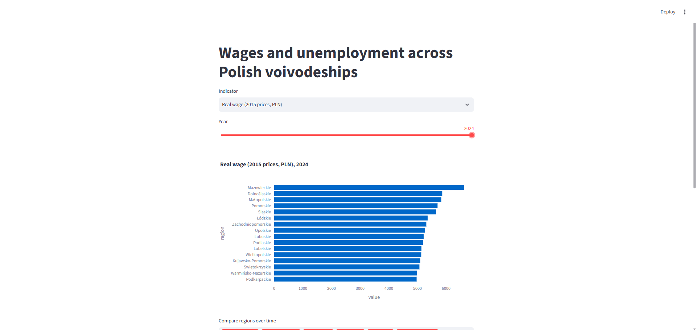
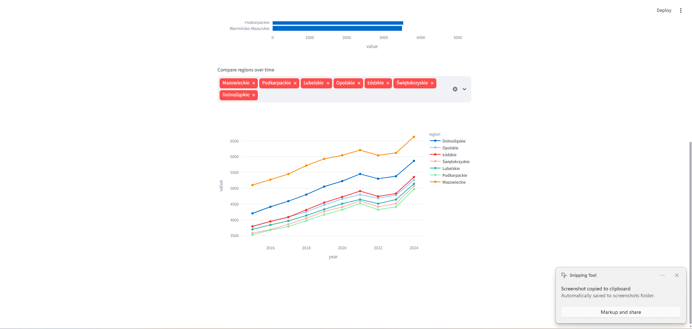

# Regional wages and unemployment in Poland, 2015-2024

**Question:** How do wages and unemployment differ across Polish voivodeships, and how has that changed over the past decade?




## Key findings
1. **Regional wage gaps narrowed.** The coefficient of variation of real wages across the 16 voivodeships fell from 10.5% in 2015 to 8.1% in 2024.
2. **The richest region grew slowest.** Mazowieckie had the lowest real wage growth (2.95% a year, about +30% over 2015-2024), followed by Śląskie (3.28%). Małopolskie grew fastest (4.55%, about +49%). Rank correlation between starting wage and growth: BETA_NUMBER.
3. **Higher wages go with lower unemployment.** The Spearman correlation between real wages and registered unemployment across regions was between -0.71 and -0.82 in every year.
4. **Unemployment fell everywhere and the gap narrowed.** The spread between the highest and lowest region shrank from 9.8 percentage points (2015) to 5.5 (2024). Warmińsko-Mazurskie had the biggest fall (15.9% to 8.0%).

## Data
- Source: GUS Local Data Bank (BDL) API.
- Wages: variable 64428, average monthly gross wage (PLN). PASTE THE BDL DEFINITION HERE.
- Unemployment: variable 461690, registered unemployment rate, December of each year.
- Prices: annual average CPI (previous year = 100), national level, SOURCE AND LINK.
- Years 2015-2024, 16 voivodeships.

## Method
1. `scripts/02_fetch.py` downloads the data from the BDL API.
2. `scripts/03_build_db.py` cleans it, deflates wages with a chained CPI index (2015 prices), and loads a SQLite database.
3. `scripts/04_analysis.py` computes real wage CAGR, sigma convergence, and per-year Spearman correlations.
4. `app.py` is a Streamlit dashboard.

## Limitations
- Wages are by workplace, not residence, so Warsaw is inflated by commuters and headquarters.
- Registered unemployment is not the LFS (Eurostat) rate and is affected by registration rules.
- Real wages use one national CPI, so regional rankings and convergence are the same as for nominal wages. There is no regional price index in Poland.
- No cost-of-living measure yet. With 16 regions, correlations are descriptive, not causal.

## How to run
```bash
python -m venv .venv
source .venv/Scripts/activate   # Windows Git Bash
pip install -r requirements.txt
python scripts/02_fetch.py
python scripts/03_build_db.py
python scripts/04_analysis.py
python -m streamlit run app.py
```

## Next steps
Eurostat LFS unemployment, powiat-level analysis, a housing-cost proxy, and a choropleth map.